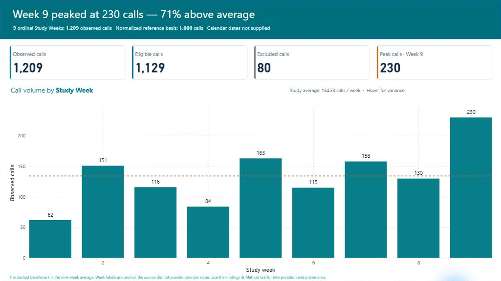
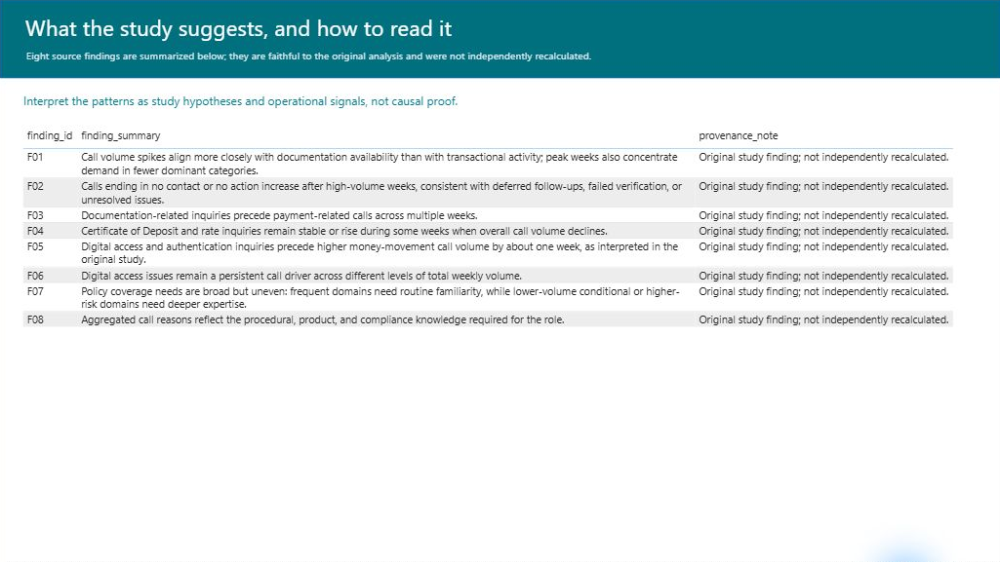

# Call Demand Analytics

A portable Power BI portfolio report for reviewing the reported call-demand profile across nine ordinal study weeks, the study’s distinct denominators, and its eight documented findings.

## Open the report

1. Extract the complete ZIP to any normal local folder.
2. Open `Call_Demand_Analytics.pbix` in Power BI Desktop for the ready-to-view report, or open `Call_Demand_Analytics.pbip` to inspect and edit the project source.
3. Use **Refresh** in Power BI Desktop. The report tables are embedded as Power Query `#table` values, so no folder parameter, local path, or network source is required.

The aggregate CSV/JSON files in `data/` are retained as the auditable source lineage for those embedded table values. The Power BI project does not read them at runtime; this makes both PBIX and PBIP self-contained after relocation.

## Objective and study scope

The report makes the observed weekly call profile, the study’s separate denominators, and its authored findings easy to review. The package includes nine weekly totals, eight sanitized summaries of the original research findings, and one methodology record. It does not contain the underlying workbook or original research documents. Week 1–9 are ordinal labels; calendar dates were not supplied.

The study reports **1,209 observed calls**. **80 nonstandard calls** were deliberately excluded from the analytical matrix, leaving **1,129 classified calls**. The **1,000-call denominator** is a separate normalization basis used by the original study. These are distinct methodological scopes, not data-quality discrepancies. Individual call records, customer information, and caller-level data are not included.

## Analysis and report pages

The report presents descriptive aggregate calculations: weekly totals, the nine-week average, the peak week, and the original study findings. It uses Power BI Desktop, PBIP/PBIR, a TMDL semantic model, Power Query, and DAX. It does not claim inferential or causal re-analysis.

- **Demand Overview** — scope cards, weekly call volume by ordinal week, average-week benchmark, and peak-week context.
- **Findings & Method** — all eight authored findings, source provenance, methodology counts, and exclusion context.

The supplied category blocks were not validated as an additive weekly fact table, so category trend analysis is not included.

## Eight documented study findings

These public summaries preserve the original study interpretations; they were not independently recalculated:

1. Call volume spikes align more closely with documentation availability than with transactional activity; peak weeks also concentrate demand in fewer dominant categories.
2. Calls ending in no contact or no action increase after high-volume weeks, consistent with deferred follow-ups, failed verification, or unresolved issues.
3. Documentation-related inquiries precede payment-related calls across multiple weeks.
4. Certificate of Deposit and rate inquiries remain stable or rise during some weeks when overall call volume declines.
5. Digital access and authentication inquiries precede higher money-movement call volume by about one week, as interpreted in the original study.
6. Digital access issues remain a persistent call driver across different levels of total weekly volume.
7. Policy coverage needs are broad but uneven: frequent domains need routine familiarity, while lower-volume conditional or higher-risk domains need deeper expertise.
8. Aggregated call reasons reflect the procedural, product, and compliance knowledge required for the role.

## Contribution and attribution

This portfolio package organizes the supplied aggregate study into a Power BI report, preserves the existing report design and authored findings, and documents the data boundaries and calculation methods. The original research findings remain attributed to the study author. No new call-level analysis, business outcome, performance improvement, or organizational adoption is claimed.

## Package contents

- `Call_Demand_Analytics.pbix` — ready-to-view Power BI report.
- `Call_Demand_Analytics.pbip` — editable Power BI project entry point.
- `Call_Demand_Analytics.Report/` — PBIR report definition and visual resources.
- `Call_Demand_Analytics.SemanticModel/` — TMDL model, DAX measures, and embedded aggregate Power Query sources.
- `data/` — sanitized CSV/JSON audit source files matching the embedded model tables.
- `docs/METHODOLOGY.md` — source lineage, calculations, exclusions, and interpretation limits.
- `docs/VALIDATION.md` — check-by-check publication validation status.
- `docs/TECHNICAL_NOTES.md` — portability implementation and package maintenance notes.
- `screenshots/` — two full-page report captures and 16 individual visual-container crops.

See [METHODOLOGY.md](docs/METHODOLOGY.md), [VALIDATION.md](docs/VALIDATION.md), and [TECHNICAL_NOTES.md](docs/TECHNICAL_NOTES.md) for details.
## Screenshots

The screenshots below are genuine captures of the report rendered in Power BI Desktop. The two full-page PNGs show the complete report canvases. The individual PNGs are crops from those same captures, included so each of the 16 report visual containers can be reviewed separately. The crops preserve the rendered pixels and do not reconstruct or redraw report content.

### Full report pages

**Demand Overview**

**Findings & Method**

### Individual visual containers

Each link opens its original-size PNG crop.

**Demand Overview**

- [Observed calls card](screenshots/individual-visuals/01-observed-calls.png)
- [Classified calls card](screenshots/individual-visuals/02-classified-calls.png)
- [Nonstandard exclusions card](screenshots/individual-visuals/03-excluded-calls.png)
- [Peak week card](screenshots/individual-visuals/04-peak-week.png)
- [Weekly call volume chart](screenshots/individual-visuals/05-weekly-call-volume.png)
- [Headline](screenshots/individual-visuals/06-demand-headline.png)
- [Study scope subtitle](screenshots/individual-visuals/07-study-scope-subtitle.png)
- [Weekly chart title](screenshots/individual-visuals/08-weekly-chart-title.png)
- [Weekly average annotation](screenshots/individual-visuals/09-weekly-average-note.png)
- [Header background shape](screenshots/individual-visuals/10-page-1-header-band.png)
- [Methodology footnote](screenshots/individual-visuals/11-methodology-footnote.png)

**Findings & Method**

- [Findings table (F01–F08)](screenshots/individual-visuals/12-research-findings.png)
- [Headline](screenshots/individual-visuals/13-findings-headline.png)
- [Study scope subtitle](screenshots/individual-visuals/14-findings-subtitle.png)
- [Interpretation note](screenshots/individual-visuals/15-interpretation-note.png)
- [Header background shape](screenshots/individual-visuals/16-page-2-header-band.png)

## Reproducibility notes

Open the PBIX for immediate viewing, or the PBIP to inspect and edit the project. Extract the package before opening either file. See [METHODOLOGY.md](docs/METHODOLOGY.md) for source lineage and denominator definitions, and [VALIDATION.md](docs/VALIDATION.md) for checks and their limits.

